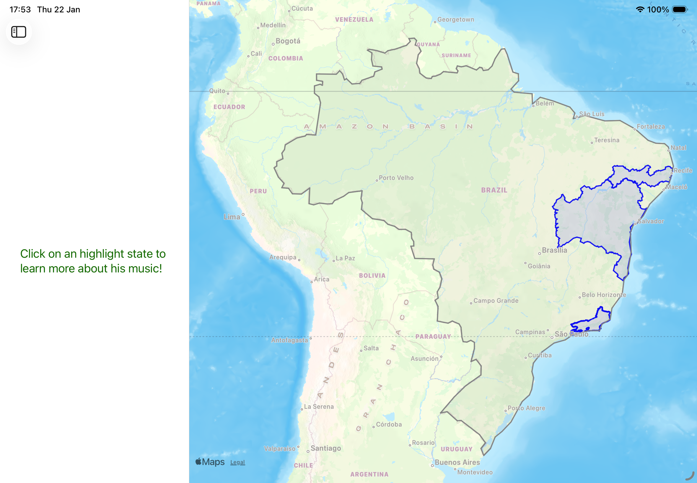
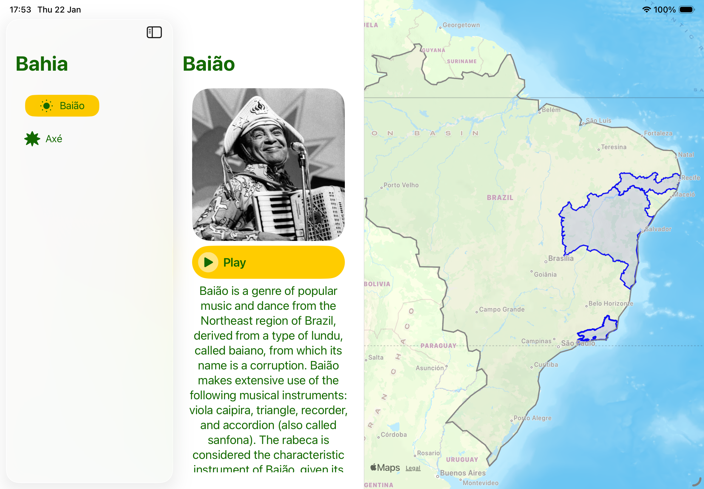
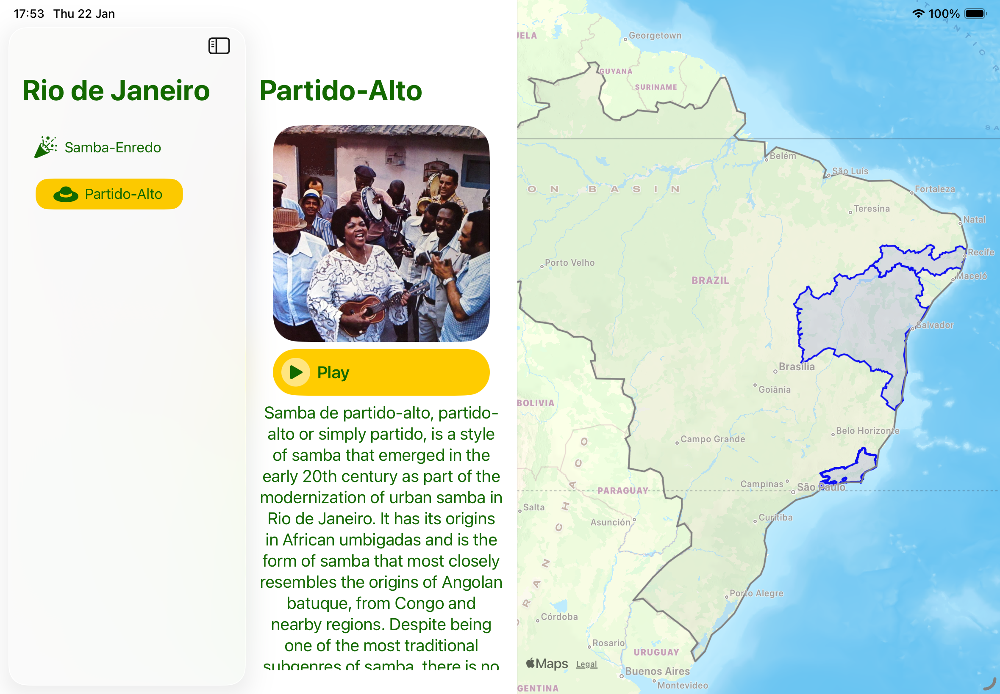

# Batuque
Batuque is an app developed for the Swift Student Challenge. The app's idea is to showcase regional Brazilian music, allowing users to explore a map of the country and interact with each state, obtaining information about its culture, customs, and, of course, music. You can listen to the rhythm, learn it in a musical minigame, and discover why Brazil is one of the most diverse countries in the world!    
The application was developed using Swift, SwiftUI, UIKit, and MapKit, in the Swift Playground development environment, following all the requirements of the Swift Student Challenge.

## App Images

